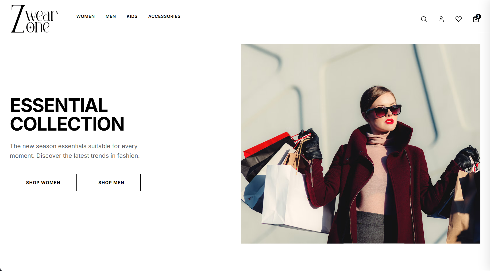
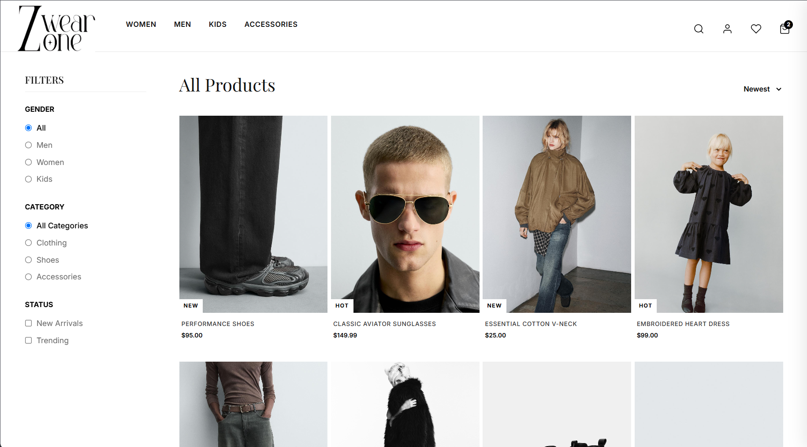
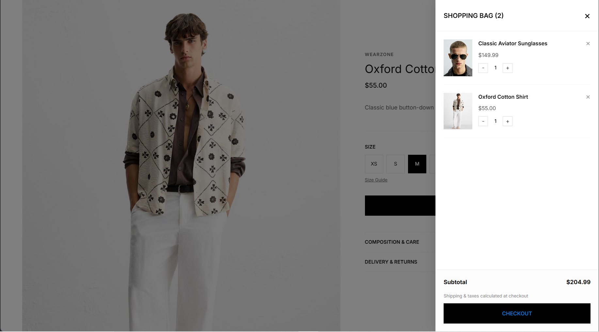
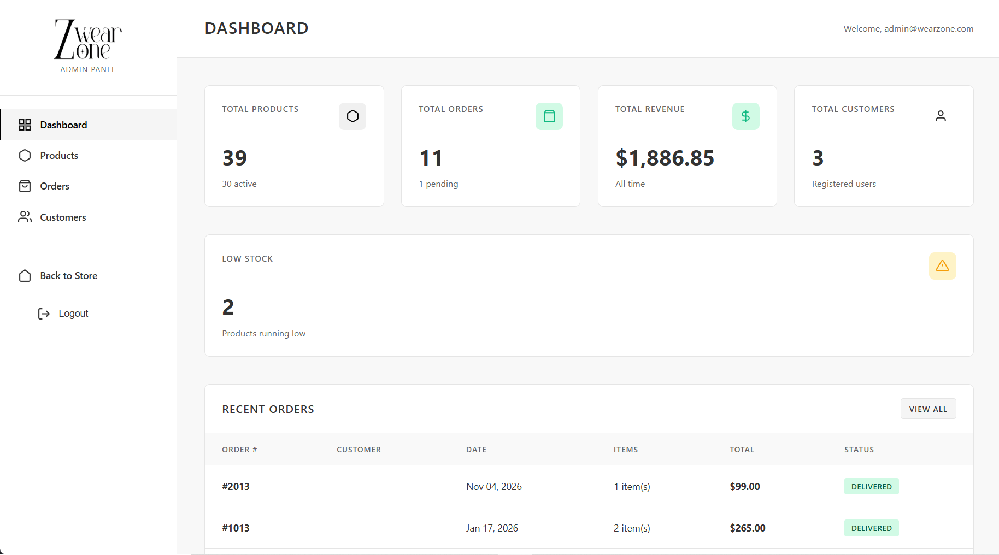
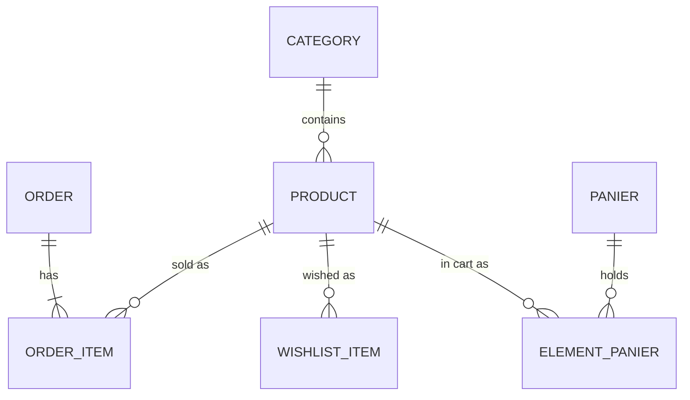

# WearZone


A full-stack e-commerce web application for a clothing store, built with **ASP.NET Core 8**, **Entity Framework Core** and **SQL Server**. It includes a customer storefront (catalog, cart, wishlist, checkout, order history) and a role-protected **admin back-office** (dashboard, products, orders, customers).

Academic project, built to practice layered web development, relational modeling and authentication on the .NET stack.

## Screenshots

| Storefront | Product catalog |
|---|---|
|  |  |

| Cart drawer | Admin dashboard |
|---|---|
|  |  |

## Features

**Storefront**
- Product catalog with filters (gender, category, sub-category, brand, new arrivals, trending), multi-term search, sorting (newest / price) and pagination (12 per page)
- Product detail page with related products
- Shopping cart served by a REST API and updated via AJAX (slide-in drawer)
- Guest carts (cookie-based session) that are **merged into the user's cart on login**
- Wishlist for authenticated users
- Checkout that creates an order with its items, prices re-read from the database server-side (never trusted from the client)
- Order history per customer
- Registration / login with ASP.NET Core Identity

**Admin area** (`/Admin`, role `Admin` only)
- Dashboard: total products / orders / customers, revenue, pending orders, low-stock and out-of-stock alerts, recent orders, top 5 selling products
- Products: full CRUD, filters, activate / deactivate, SKU generation. Deleting a product that appears in past orders **deactivates it instead**, so order history is preserved
- Orders: filtering, detail view, status workflow (`Pending` → `Processing` → `Shipped` → `Delivered` / `Cancelled`)
- Customers: list with order count and total spent, detail view with orders and wishlist

## Tech stack

| Layer | Technology |
|---|---|
| Framework | ASP.NET Core 8 (Razor Pages for the storefront, MVC Areas for the admin, API controllers for cart and wishlist) |
| Language | C# 12 |
| ORM | Entity Framework Core 8 (Code First, migrations) |
| Database | Microsoft SQL Server |
| Auth | ASP.NET Core Identity with roles (`Admin`, `Customer`) |
| Front-end | Razor views, Bootstrap, vanilla JavaScript (`fetch`), jQuery Validation |

## Architecture

```
WearZone/
├── WearZone.sln
├── docs/                      # UML diagrams (Mermaid)
└── WearZone/
    ├── Areas/
    │   ├── Admin/             # MVC: Dashboard, Products, Orders, Customers
    │   └── Identity/          # Login / Register / Logout pages
    ├── Controllers/           # REST API: CartController, WishlistController
    ├── Data/                  # ApplicationDbContext
    ├── Migrations/            # EF Core migrations
    ├── Models/                # Entities
    ├── Pages/                 # Razor Pages: catalog, product, cart, checkout, account
    ├── Services/              # DataSeeder
    ├── wwwroot/               # CSS, JS, static assets
    └── Program.cs             # DI, pipeline, seeding
```

### Data model




### REST endpoints

| Method | Route | Description |
|---|---|---|
| GET | `/api/cart` | Current cart (guest or authenticated) |
| POST | `/api/cart/add` | Add a product (body: product id) |
| POST | `/api/cart/decrease` | Decrease quantity by one |
| POST | `/api/cart/remove` | Remove a product |
| POST | `/api/wishlist/toggle` | Add / remove from wishlist (auth required) |
| GET | `/api/wishlist/check?productId=` | Is the product in the wishlist? |

## Security notes

- Role-based authorization (`[Authorize(Roles = "Admin")]`) on the whole admin area
- Anti-forgery tokens on all state-changing admin actions, including AJAX calls (token sent in the `RequestVerificationToken` header)
- Mass-assignment protection on product create / edit (explicit field whitelist)
- Foreign key from order items to products set to `Restrict`, so order history cannot be lost by deleting a product
- No credentials in the repository: the admin password is read from configuration (user secrets / environment variable)

## Getting started

### Prerequisites
- [.NET 8 SDK](https://dotnet.microsoft.com/download/dotnet/8.0)
- SQL Server (Express, Developer or LocalDB)
- EF Core CLI: `dotnet tool install --global dotnet-ef`

### 1. Clone

```bash
git clone https://github.com/YacineDaher/WearZone.git
cd WearZone/WearZone
```

### 2. Configure the database

The default connection string in `appsettings.json` targets a local SQL Server with Windows authentication:

```
Server=localhost;Database=WearZoneDB;Trusted_Connection=True;MultipleActiveResultSets=true;TrustServerCertificate=True
```

To use another instance (for example LocalDB), override it without touching the file:

```bash
dotnet user-secrets set "ConnectionStrings:DefaultConnection" "Server=(localdb)\\MSSQLLocalDB;Database=WearZoneDB;Trusted_Connection=True;TrustServerCertificate=True"
```

### 3. Set the admin password

An admin account is created on first startup. Choose its password locally; it is never stored in the repo:

```bash
dotnet user-secrets set "AdminPassword" "YourStrongPassword1!"
```

### 4. Create the database and run

```bash
dotnet ef database update
dotnet run --launch-profile https
```

Open `https://localhost:7231`. On first startup the app seeds the roles, the admin account and a set of sample products.

- Storefront: `https://localhost:7231`
- Admin panel: `https://localhost:7231/Admin/Dashboard` (log in with `admin@wearzone.com` and the password from step 3)


This is an academic project;

## Author

**Mohammed Yacine Daher**, engineering student
GitHub: [@YacineDaher](https://github.com/YacineDaher)